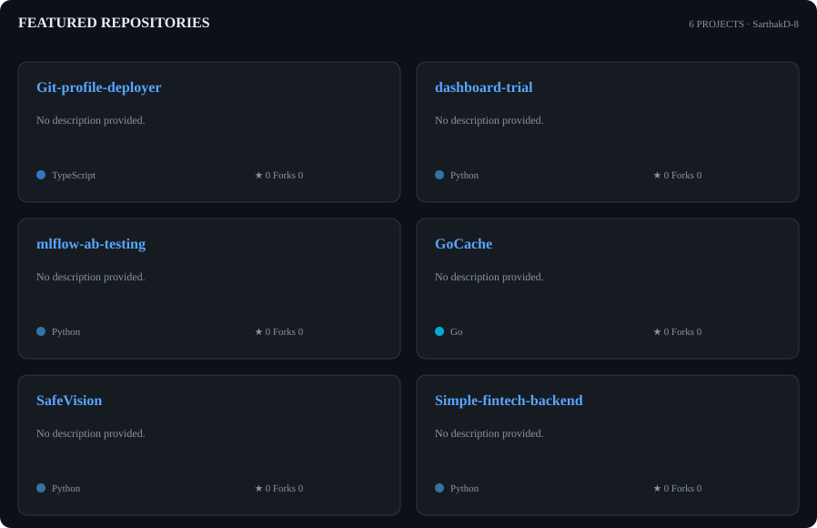

<div align="center">
  <a href="https://my-new-prof.vercel.app/">
    
  </a>
</div>

---

## `01 / About Me`

```python
class Sarthak:
    def __init__(self):
        self.role = "AI & Data Science Engineer"
        self.interests = [
            "Artificial Intelligence",
            "Data Engineering",
            "Machine Learning",
            "Backend Engineering",
            "Full-Stack Development"
        ]
        self.languages = ["Python", "SQL", "TypeScript"]
        self.philosophy = "Build useful things. Understand deeply."
```

I'm interested in engineering systems that solve practical problems, from intelligent data pipelines to full-stack applications.

- Developing AI/ML and data-driven applications.
- Exploring scalable backend and data architectures.
- Building automation and developer productivity tools.
- Learning through experimentation and engineering.

## `02 / Tech Stack`

**Languages**


**AI / Machine Learning**


**Backend / Data Engineering**


**Frontend / Tools**


## `03 / Selected Projects`

<div align="center">
  
</div>

## `04 / Contribution Intelligence`

<div align="center">
  
</div>

### Contribution Activity

<div align="center">
  
</div>

## `05 / Current Focus`

```text
[+] Machine Learning & Generative AI
[+] Data Engineering & Analytics
[+] Backend Architecture
[+] MLOps & Experiment Tracking
[+] Building useful developer tools
```

## `06 / Connect`

<div align="center">

**Interested in building something meaningful? Let's connect.**

[](https://portfolio-website-kappa-one-98.vercel.app/)
[](https://github.com/SarthakD-8)

---

<sub>Building, learning, experimenting — one commit at a time.</sub>

</div>